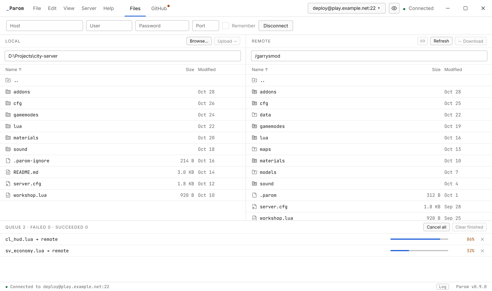
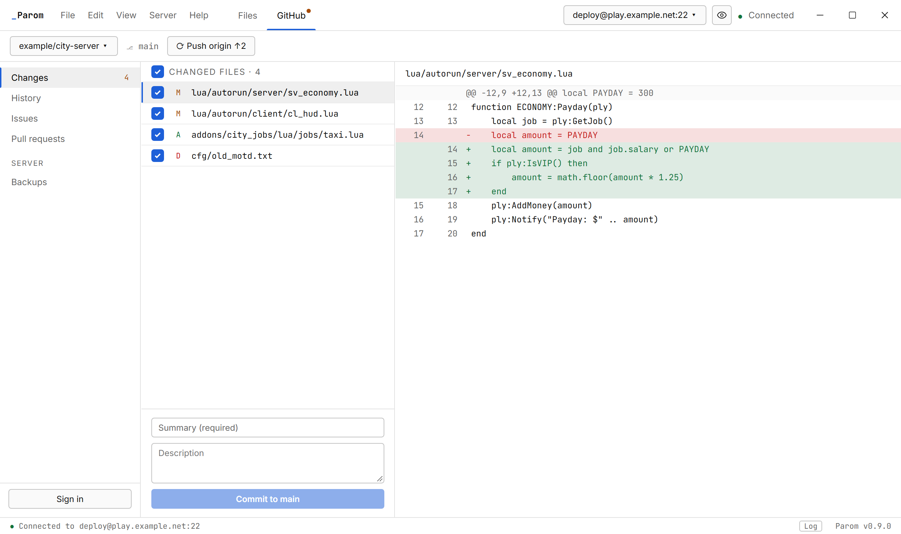
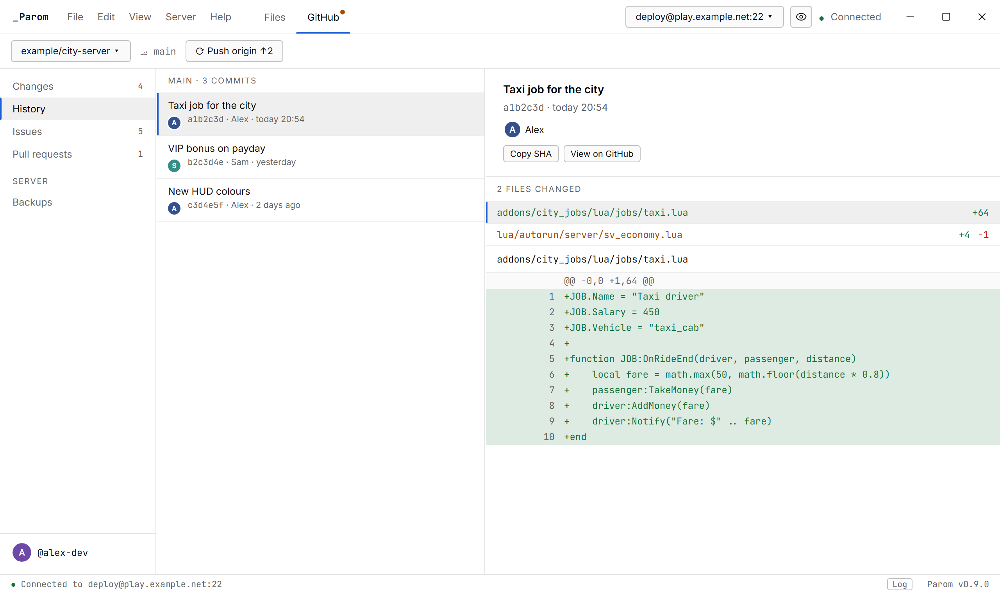
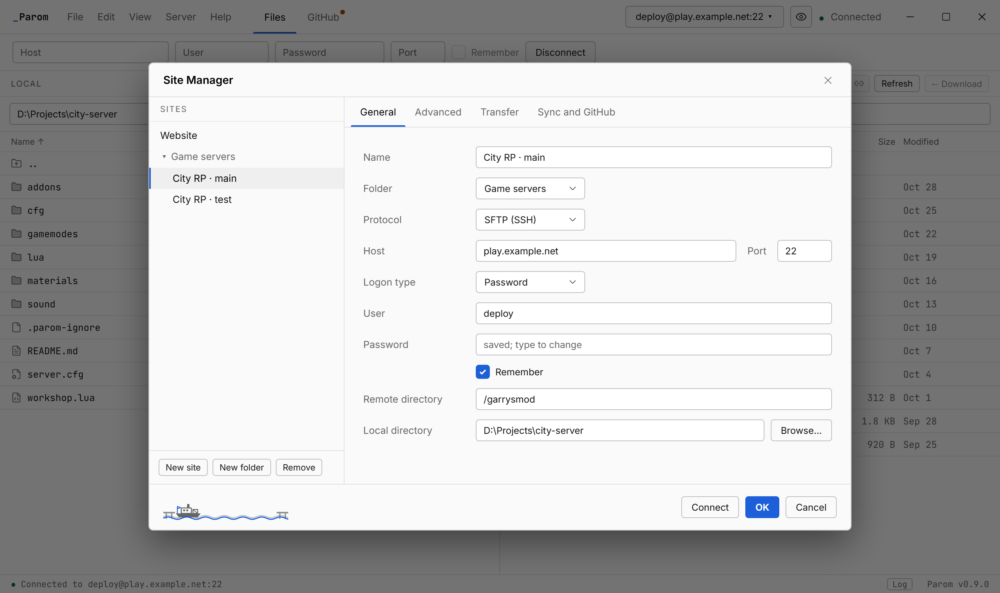

<div align="center">


# Parom

**An SFTP / FTP client with a GitHub tab and version-aware server sync.**<br>
Built on the FileZilla engine, for people who deploy game servers and small sites from a git repository.

[](https://github.com/yarbb/parom/releases)
[](https://github.com/yarbb/parom/actions/workflows/build.yml)
[](https://github.com/yarbb/parom/releases)
[](LICENSE)

[](https://tauri.app)
[](https://svelte.dev)
[](https://www.typescriptlang.org)
[](https://www.rust-lang.org)
[](daemon)
[](https://filezilla-project.org)
[](https://github.com/yarbb/parom/releases)

[Download](https://github.com/yarbb/parom/releases) · [Report a problem](https://github.com/yarbb/parom/issues/new) · [Translate](locales/README.md)

</div>

*Parom* is Russian for "ferry": it carries your files from the repository to the server and back.

<p align="center">
  
</p>

<p align="center">
  
</p>

<table>
  <tr>
    <td width="33%"></td>
    <td width="33%"></td>
    <td width="33%"></td>
  </tr>
  <tr>
    <td align="center"><sub>Changes</sub></td>
    <td align="center"><sub>History</sub></td>
    <td align="center"><sub>Site Manager</sub></td>
  </tr>
</table>

<p align="center"><sub>Screenshots use made-up servers, folders and accounts.</sub></p>

## Download

Get the installer from [**Releases**](https://github.com/yarbb/parom/releases). It installs for your user only (no administrator rights), and Parom updates itself when you agree to it.

> [!NOTE]
> The installer is not code-signed yet, so Windows SmartScreen may say "Windows protected your PC". Click **More info**, then **Run anyway**. Updates are signed with the project's own key, and Parom refuses any update that is not.

Windows 10 and 11 for now; a Linux AppImage is on the way.

## Features

### Files
- Dual-pane file manager for **SFTP, FTP and FTPS**, with a Site Manager and passwords in the system's credential store.
- Drag and drop between the panes, from Explorer and out to Explorer; simultaneous transfers; edit server files in place.
- Synchronized browsing (`Ctrl+Y`), folders that exist on both sides tinted grey, colour labels for folders.
- Automatic reconnect, and unfinished transfers can be continued after a restart.

### Sync
- A tiny marker file on the server (`/.parom`, about 300 bytes) records which commit is deployed.
- Parom tells you when the server is behind, was synced by someone else, or was edited by hand.
- Backups of everything a sync overwrites, with restore, and "Back up now" without syncing.
- Server → repository: take changes made on the server back into your working folder.

### GitHub
- **Changes**, **History**, **Issues** and **Pull requests**, like GitHub Desktop: commit, discard, push, pull, comment, close, merge.
- Commits with `Fixes #12` close their issue once a sync deploys them.
- Sign in with the browser (GitHub App) or a fine-grained token; the token stays in the credential store.

### And
- Dark and light themes with accent colours; English and Russian.
- Optional Discord Rich Presence (off by default, never shows server addresses).
- Signed in-app updates from this repository.

## Privacy
Parom talks to your servers, to GitHub (only when you sign in) and to this repository's releases (to look for updates). Nothing else, no telemetry. Discord Rich Presence is off unless you turn it on, and it never shows server addresses or site names.

## Building
GitHub Actions builds everything on `windows-latest`: the FileZilla engine and the `paromd` daemon with MSYS2, then the Tauri app and its installer, with tests against local SFTP, FTP and FTPS servers. No local C++ toolchain is needed.

```
daemon/        paromd: C++ wrapper around the FileZilla engine, JSON-RPC over stdio
app/           Tauri 2 (Rust) + Svelte 5 UI
locales/       translations (en.json is the source of truth)
docs/releases/ release notes, one file per version
third_party/   FileZilla 3.71.1 source (verified, see NOTICE)
```

A tag `vX.Y.Z` publishes a release with the notes from `docs/releases/X.Y.Z.md`.

## Translations
Parom is in English and Russian. To add a language, copy `locales/en.json`, translate the values and send a pull request; see [locales/README.md](locales/README.md).

## License
[GPLv3 or later](LICENSE). Parom includes the FileZilla engine (GPL), libfilezilla and fzssh (AGPL), the Inter and JetBrains Mono fonts (OFL) and Lucide icons (ISC); see [NOTICE](NOTICE).
